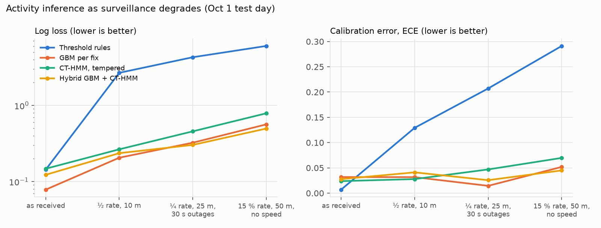
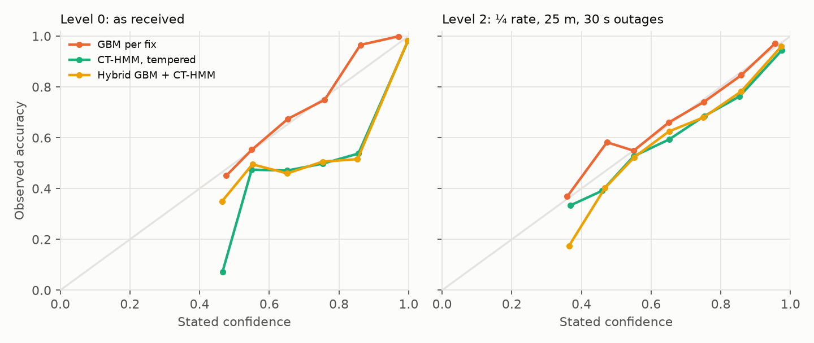
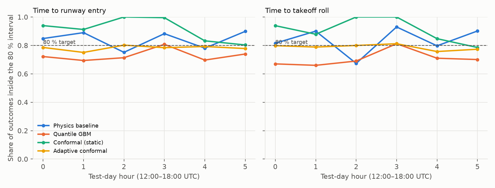
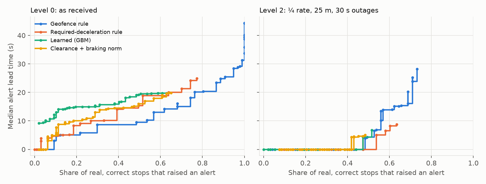

# surface-safety-nowcast

Predicting unsafe operations on an airport surface from live surveillance and ATC voice, measured the way a safety system has to be measured: calibrated confidence, alert lead time against false alerts, behaviour as inputs degrade or disappear.

Built on **18 hours of real traffic at Washington Dulles (KIAD)**. That's three ADS-B Exchange sample days, 12:00–18:00 UTC: 341,867 position fixes, 5,038 tracks, 514 departures and 378 landings. It also uses **real controller–pilot audio** (UWB-ATCC and ATCO2). Training uses Aug 1 and Sep 1; **every number below is from Oct 1, a day no model saw**.

| Part | Question | Headline result (Oct 1 test day) |
|---|---|---|
| [State estimation](#1-what-is-each-aircraft-doing) | What is each aircraft doing right now, and how sure are we? | Hybrid GBM + continuous-time HMM stays calibrated as surveillance degrades: **ECE 2.6 %** at ¼ update rate and 25 m noise, where threshold rules hit 20.7 % |
| [Time to event](#2-when-will-it-reach-the-runway) | When will a departure reach the runway / start its roll? | Within the last minute: **19 s median error, 98 % of outcomes inside the 80 % interval** |
| [Hold-short violations](#3-will-it-stop-at-the-hold-short-line) | Will this aircraft stop at the hold line? | **99 % of simulated failures-to-stop caught, median 10.7 s before entering the runway area**, 7 % false alerts on real compliant stops. Every alerter collapses when ADS-B degrades |
| [Sensor fusion](#4-fusing-ads-b-ground-radar-and-a-camera) | Can a camera cover targets that broadcast nothing? | EKF + JPDA with a (simulated) camera halves position error: **22.5 m → 13.5 m RMS**. When ADS-B targets go silent, coverage stays at **96 %** (cooperative-only: 6 %) |
| [ATC speech](#5-atc-speech-to-structured-intent) | Can we turn a transmission into callsign + instruction in ~1 s? | LoRA fine-tuned Whisper: **WER 98.9 % → 33.4 %**, **1.1 s median latency on a laptop CPU**. Unseen airports: 59.7 % → 37.5 % |
| [Voice gating](#6-what-asr-accuracy-means-for-false-alerts) | What does ASR accuracy buy operationally? | Authorised runway entries alarm **35 times an hour** without voice; fine-tuned ASR cuts that to **18–22 an hour**. Callsign recognition is the bottleneck |

The failures are reported with the same prominence as the wins. A model that only shows its good side can't be defended in a program review.

---

## Data

| Source | What | Used for |
|---|---|---|
| [ADS-B Exchange sample days](https://www.adsbexchange.com/products/historical-data/) (readsb-hist, 5 s snapshots) | ADS-B, **TIS-B** (ground-radar targets rebroadcast to aircraft: the non-cooperative picture), ADS-R vehicles, within ~10 km of KIAD | Everything surface-related |
| [OpenStreetMap](https://www.openstreetmap.org) via Overpass | 4 runways, 289 taxiway segments, 53 runway hold-short lines | Geometry, taxi-route graph, hold-line offsets |
| [UWB-ATCC](https://huggingface.co/datasets/Jzuluaga/uwb_atcc) (CC BY-NC-SA 4.0) | ~13 h Czech approach/tower audio, 8 kHz | Whisper fine-tuning + in-domain test |
| [ATCO2 1 h test set](https://huggingface.co/datasets/Jzuluaga/atco2_corpus_1h) | Several European airports | Out-of-domain test only |

`readsb-hist` repeats a target's last position until a new one arrives, so the real fix time is `now − seen_pos`; duplicates are dropped and tracks are split at gaps over 2 minutes. Real update intervals are irregular: median 5.1 s, 99th percentile 20 s.

**Labels.** Each fix gets one of seven activity states: STOPPED, TAXI, HOLD_SHORT, RWY_SLOW, TAKEOFF_ROLL, LANDING_ROLL, AIRBORNE. They're assigned **in hindsight from the complete, clean track**: a takeoff roll is "fast on the runway *and* airborne within 90 s". Online models never see the future or the clean track, so the labels are a fair grading key. One caveat: the labels come from threshold logic on clean data, so the threshold-rule baseline is near-perfect on clean data *by construction*. Compare the models on degraded data.

**Degradation levels** (applied to test tracks, same random seeds for every model):

| Level | Updates kept | Position noise | Speed | Outages |
|---|---|---|---|---|
| 0 | as received | as received | reported | none |
| 1 | 50 % | 10 m | reported ± 2 kt | none |
| 2 | 25 % | 25 m | reported ± 4 kt | 30 s, ~1 per 10 min |
| 3 | 15 % | 50 m | **not available** | 60 s, ~1 per 10 min |

---

## 1. What is each aircraft doing?

`src/activity.py`

* **Continuous-time HMM.** Transitions are `P(Δt) = expm(Q·Δt)`, with the generator `Q` estimated from labelled dwell times. Irregular sampling is handled exactly, not by resampling. Emissions are Gaussian mixtures on speed, distance to runway, distance to the nearest hold line, acceleration and heading alignment. Forward filtering only.
* **Emission tempering.** Emissions fitted on clean data are over-confident on degraded input. Each log-likelihood is scaled by β(level), fitted on validation tracks; the level is known online from NACp and update gaps. Fitted β falls from 1.0 to 0.02 as data degrades.
* **Hybrid.** A gradient-boosted per-fix classifier, turned into a scaled likelihood `p(s|x)/p(s)` inside the same continuous-time filter. That gives the discriminative model's accuracy plus the HMM's temporal consistency.



| Level | Threshold rules | GBM per fix | CT-HMM (tempered) | **Hybrid GBM + CT-HMM** |
|---|---|---|---|---|
| 0 | acc 0.993 · ECE 0.007 | 0.985 · 0.032 | 0.967 · 0.024 | 0.955 · 0.028 |
| 1 | 0.871 · 0.129 | 0.934 · 0.032 | 0.906 · 0.028 | 0.915 · 0.041 |
| 2 | 0.793 · **0.207** | 0.882 · 0.014 | 0.811 · 0.047 | **0.886 · 0.026** |
| 3 | 0.709 · **0.291** | 0.789 · 0.052 | 0.692 · 0.070 | **0.816 · 0.045** |

Log loss at level 3: rules 6.04, untempered HMM 3.49, tempered HMM 0.79, **hybrid 0.50**. Rules stay just as confident when they become wrong, which is the failure mode that matters for an alerting system. Tempering alone fixes most of the HMM's over-confidence but costs macro-F1 on rare states (0.30 at level 3), because the flattened emissions let the prior swamp short events like a takeoff roll. The hybrid avoids that.



## 2. When will it reach the runway?

`src/eta.py`. At every fix while a departure taxis, it predicts seconds until **runway entry** and until **takeoff-roll start**. The assigned runway end is treated as known (it's in the taxi clearance); the entry intersection, queue and timing are not.

* Features: taxi-route distance over the OSM taxiway graph, current and 60 s mean speed, time since first movement, aircraft queued at that runway end, aircraft inbound within 1.5 km, recent departures and arrivals.
* Models: a physics baseline (route distance at 15 kt plus the median wait), quantile gradient boosting (10/50/90 %), **conformalised quantile regression** (CQR), and **adaptive conformal inference** (ACI, Gibbs & Candès 2021). ACI updates its miscoverage level only from outcomes that have actually resolved, meaning departures that have already rolled, so it never uses information from the future.
* Evaluation is **rolling-origin** over the test day: to predict hour *h*, train on every departure before hour *h*.

| Time to runway entry | MAE | 80 % coverage [95 % CI] | Mean width |
|---|---|---|---|
| Physics baseline | 182 s | 0.86 [0.83–0.89] | 734 s |
| Quantile GBM | **123 s** | 0.72 [0.69–0.76] | 305 s |
| **CQR** | **123 s** | **0.87** [0.84–0.91] | 449 s |
| ACI | 123 s | 0.78 [0.74–0.81] | 1,218 s |

| Horizon (CQR) | n | MAE | Coverage | Width |
|---|---|---|---|---|
| < 1 min | 1,825 | **19 s** | 0.98 | 200 s |
| 1–3 min | 3,838 | 49 s | 0.94 | 336 s |
| 3–7 min | 7,330 | 82 s | 0.95 | 440 s |
| > 7 min | 9,313 | 207 s | 0.76 | 552 s |

(22,306 predictions from 166 test-day departures; the coverage CI is a bootstrap over departures, since predictions within a departure are correlated.)



What the numbers say:
* **Raw quantiles under-cover.** They reach 72 % against an 80 % target, so a calibration layer is not optional.
* **The two conformal methods each won once.** On a first single-day version of this experiment (train on 08:00–12:00 local, test on the midday departure bank), static CQR fell to 36 % coverage in the rush hour. Taxi times jumped from 14 to 24 minutes and runway use shifted. ACI held 76 % in every hour. With three days of training the shift shrinks: static CQR is better calibrated *and* narrower, while ACI pays for its robustness with very wide intervals. Production would use ACI as the safety net and CQR as the default.
* **Beyond 7 minutes the forecast is weak.** The wait is dominated by things this data doesn't contain: pushback approval, departure flow restrictions, wake-turbulence spacing. That is where SWIM (TFMS, TBFM) feeds would go next.
* **Route distance carries most of the signal.** Permutation importance, as the increase in MAE: route distance +88 s, straight-line distance +47 s, speed +18 s, queue +16 s, recent same-runway departures +11 s.

The level-2 degraded input changes MAE by only 10–15 s; the intervals stay calibrated (CQR 0.87).

## 3. Will it stop at the hold-short line?

`src/incursion.py`. Real runway incursions are rare, and none occur in this data. So:

* **Real events.** 330 approaches to a runway hold line that ended in a correct stop (median hold 42 s).
* **Counterfactual twins.** The same real track up to the moment braking began, then continuing at the approach speed and heading, i.e. the aircraft fails to stop. 227 twins enter the runway's protected area (|offset from centreline| < that hold line's offset); 130 are in training, 97 in test.
* **Graded on both:** lead time = protected-area entry minus first alert, on the twins; false alert rate = the share of real compliant stops that raised any alert.
* **Thresholds chosen on training events only,** using **out-of-fold** predictions for the learned model. Choosing on in-sample predictions gave 5 % false alerts in training and 19 % in test.

Alerters: a geofence rule; a required-deceleration rule (`v²/2d` above what taxiing aircraft use); a learned GBM for P(enter protected area within 20 s); and a clearance-aware rule that alerts when the aircraft is closer than where 95 % of compliant aircraft had started braking at that speed and still isn't slowing.

| Input | Alerter | Detected | Median lead | ≥ 10 s lead | False alerts (real stops) |
|---|---|---|---|---|---|
| ADS-B as received | Geofence | 27 % | 0 s | 1 % | 4.1 % |
| | Required decel. | 39 % | 0 s | 1 % | 2.1 % |
| | **Learned GBM** | **99 %** | **10.7 s** | **64 %** | 7.2 % |
| | Clearance + braking norm | 13 % | 0 s | 1 % | 3.1 % |
| ADS-B ½ rate, 10 m | best (GBM) | 22 % | 0 s | 4 % | 4.1 % |
| ADS-B ¼ rate, 25 m | best | 10–13 % | 0 s | ≤ 6 % | 4–9 % |
| 2 Hz camera only, 4 m | Required decel. | **100 %** | 4.7 s | 5 % | 10.3 % |
| | Geofence | 98 % | 2.6 s | 1 % | 5.2 % |
| | Learned GBM | 27 % | 0 s | 2 % | 1.0 % |

The median physically available warning, from braking onset to protected-area entry, is about **35 s**.



What the numbers say:
* **Kinematics alone can't separate "about to brake" from "won't brake" until late.** At 7 kt, the deceleration needed to stop stays under 0.3 m/s² until 5–10 s before the line. The learned model gets 10.7 s because it learns *where* compliant aircraft start slowing, not just whether a stop is still possible.
* **Degraded surveillance is the dominant risk.** At ½ update rate, no alerter catches more than 22 %. A 5–20 s update interval against a ~35 s event leaves one or two fixes to decide on.
* **A 2 Hz sensor restores detection but not lead time.** On camera input the rules catch everything, but only seconds ahead. The GBM, trained on camera-level features that lack reported speed, did not transfer.
* **The clearance-aware rule underperformed** at every level except camera. Its braking-onset estimate from 5 s ADS-B is too noisy: a compliant aircraft is often "past where 95 % would have braked" between two fixes. That's a negative result, kept in.

## 4. Fusing ADS-B, ground radar and a camera

`src/fusion.py`. The ADS-B and TIS-B reports are real. **The camera is simulated**, because no labelled KIAD surface video is public. It's fixed at the hold line with the most real hold-short stops and samples the real tracks (smoothed, interpolated to 0.5 s): 2 Hz, 450 m radius, P<sub>d</sub> = 0.9, noise 2 m + 1 % of range, Poisson clutter, **no identities**, and a **clock running 0.4 s late**.

* **EKF**, state `[x, y, vx, vy]`. ADS-B reports ground speed and track, which are nonlinear in the velocity state, so the update is linearised. When stopped, the heading row is dropped.
* **JPDA** with exact joint-event enumeration inside gate clusters, plus the spread-of-innovations covariance term. Unassociated detections start camera-only tracks (confirmed after 4 hits).
* **Clock offset estimated, not assumed.** On a training-day hour, it picks the offset that minimises the squared distance between camera detections and moving cooperative targets. Parked targets carry no timing information and are excluded.

Evaluated over the first 30 minutes of the test day: 35 targets crossed the camera area (16 ADS-B, 19 TIS-B), 11,757 target-seconds, scored at 1 Hz against truth.

| Tracker | RMS error | p95 error | Time with error > 15 m | Coverage | Camera detections assigned correctly |
|---|---|---|---|---|---|
| ADS-B + TIS-B only | 22.5 m | 40.6 m | 15.6 % | 100 % | — |
| **+ camera, fused** (no clock correction) | **13.5 m** | 25.0 m | **6.7 %** | 100 % | 80 % |
| + camera, fused, *estimated* clock correction | 14.0 m | 30.1 m | 7.9 % | 100 % | 75 % |
| Camera only (all cooperative input lost) | 4.6 m* | 7.6 m* | 1.1 %* | 99 % | — |

**Input loss.** Every second ADS-B aircraft is made to stop transmitting. On those aircraft, the fused tracker keeps **96 % coverage at 7.0 m RMS**; the cooperative-only tracker covers 6 % of their time, and 74 % of that is more than 15 m off.

What the numbers say:
* **The camera halves the error.** Most cooperative-only error is extrapolation between 5 s updates on turning targets, plus noisy TIS-B radar returns. 2 Hz detections pin those down.
* **The clock-offset estimate failed.** It returned −0.10 s against a true +0.40 s, and applying it made tracking slightly *worse* than no correction. At taxi speeds 0.5 s is 3–4 m, below the noise floor set by detection noise and by the gap between raw reports and the smoothed reference. Estimating timing needs targets moving faster than taxiing aircraft (runway traffic), or an explicit clock state in the filter.
* \* **The camera-only numbers are optimistic by construction.** The simulated camera samples the same smoothed trajectories used as truth, so it is graded against its own source. The comparison that holds up is the *relative* one (fused vs cooperative-only, and coverage under input loss), not camera-only accuracy.

## 5. ATC speech to structured intent

`src/asr.py`, `src/atc_text.py`

* **Whisper-small with LoRA** (rank 32 on q/v projections, 3.5 M trainable parameters, 1.4 %), gradient checkpointing, **500 steps × batch 4 = 2,000 utterances (~2 h of audio)** sampled from the 10.5 h UWB-ATCC training split, run on CPU in 144 minutes.
* **Normalisation** maps Whisper's output ("Lufthansa 4AB, runway 27") onto the corpus convention ("lufthansa four alfa bravo runway two seven"). That way WER counts recognition errors, not formatting.
* **Parser.** Callsign (airline telephony + digits, or a spoken registration), runway with L/C/R, hold short, cross, line up, cleared takeoff/land, taxi-via list.

| | UWB test (in-domain) | | ATCO2 (unseen airports) | | Latency, 1 transmission (CPU) |
|---|---|---|---|---|---|
| | WER | Callsign recall | WER | Callsign recall | p50 / p95 |
| Whisper-small zero-shot | 98.9 % | 5 % | 59.7 % | 5 % | 2.46 / 3.10 s |
| **+ LoRA** | **33.4 %** | **57 %** | **37.5 %** | **23 %** | **1.08 / 1.45 s** |

Slot recall (fine-tuned, UWB / ATCO2): runway 74 % / 67 %, line up 80 % / 70 %, cross — / 69 %, cleared takeoff 59 % / 50 %.

Zero-shot Whisper on 8 kHz radio doesn't just mis-hear; it **invents fluent sentences**. "aero flot one four nine ruzyne tower roger" came out as "i have a photo of the one i never seen before in my life". Those inventions are *not* aviation language, so they never parse as a command: the zero-shot **spurious-command rate** (a hold-short, cross, line-up or takeoff/landing clearance in the ASR output that isn't in the reference) is 0 %. The fine-tuned model has the opposite profile. It speaks the phraseology, so when it is wrong it is wrong *plausibly*: spurious commands in **1.3 %** of in-domain transmissions and 0.3 % at unseen airports. A system that acts on parsed clearances has to treat that as a hazard in its own right. Gating on ASR confidence and cross-checking against the surveillance picture are the obvious mitigations.

## 6. What ASR accuracy means for false alerts

`src/voice_gate.py`. A runway-conformance monitor alerts whenever a target enters a runway. On the test day there were **212 authorised ground entries in 6 h (35 per hour)**, mostly departures lining up on runway 30. Without voice, every one is a false alert. With voice, an entry is cleared only if the parsed transmission has the right **callsign, runway and instruction**; joint accuracy is measured per transmission on real audio.

| ASR | Joint parse accuracy (UWB / ATCO2) | False alerts per hour at KIAD |
|---|---|---|
| None | — | 35.3 |
| Whisper-small zero-shot | 13 % / 25 % | 30.7 / 26.5 |
| **+ LoRA** | **50 % / 37 %** | **17.8 / 22.1** |

That halves the false alerts, but 18 an hour is still far from deployable. The bottleneck is the callsign. The next steps are callsign biasing from the surveillance picture (the flights actually on frequency), contextual decoding with a callsign prompt, and training on US phraseology.

---

## Limitations

* **The camera is simulated.** Real detection (YOLO-class, ByteTrack) needs labelled airport-surface video, which isn't public; the tracker and association are real code running on simulated detections from real trajectories.
* **The incursions are counterfactual.** Twins assume the aircraft keeps its approach speed and heading. Real failures-to-stop include slowing late, which would be harder to catch.
* **18 hours at one airport,** with a single runway configuration family. Night operations, weather and snow removal are absent.
* **The ATC audio is European** (Czech and other airports), while the surveillance is US. Phraseology differs ("holding point" vs "hold short"), so a KIAD deployment needs US audio (e.g. LiveATC under licence).
* **Labels are hindsight rules, not human annotation;** see the caveat in [Data](#data).

## Run it

```bash
python3 -m venv .venv && .venv/bin/pip install -r requirements.txt
./run_all.sh   # ~4 h on an Apple M4 CPU, mostly Whisper
```

Results land in `reports/*.json`; figures in `reports/figures/`.

```
src/
  fetch_adsbx.py   fetch_osm.py   fetch_speech.py    data
  airport.py       local frame, runways, hold lines, taxiway graph (networkx)
  tracks.py        de-duplication, track segmentation, hindsight labels
  activity.py      CT-HMM, tempering, GBM, hybrid; calibration under degradation
  eta.py           quantile GBM, CQR, adaptive conformal; rolling-origin evaluation
  incursion.py     counterfactual twins, four alerters, lead time vs false alerts
  fusion.py        EKF, JPDA, camera simulation, clock-offset estimation, input loss
  asr.py           Whisper zero-shot / LoRA training / evaluation / latency
  atc_text.py      normalisation and clearance parser
  voice_gate.py    ASR accuracy -> false alerts per hour
  report.py        figures
```

Data: ADS-B Exchange sample data; © OpenStreetMap contributors (ODbL); UWB-ATCC (Šmídl et al., CC BY-NC-SA 4.0); ATCO2 (Zuluaga-Gomez et al. 2022). Transcripts derived from those corpora are not redistributed here.
